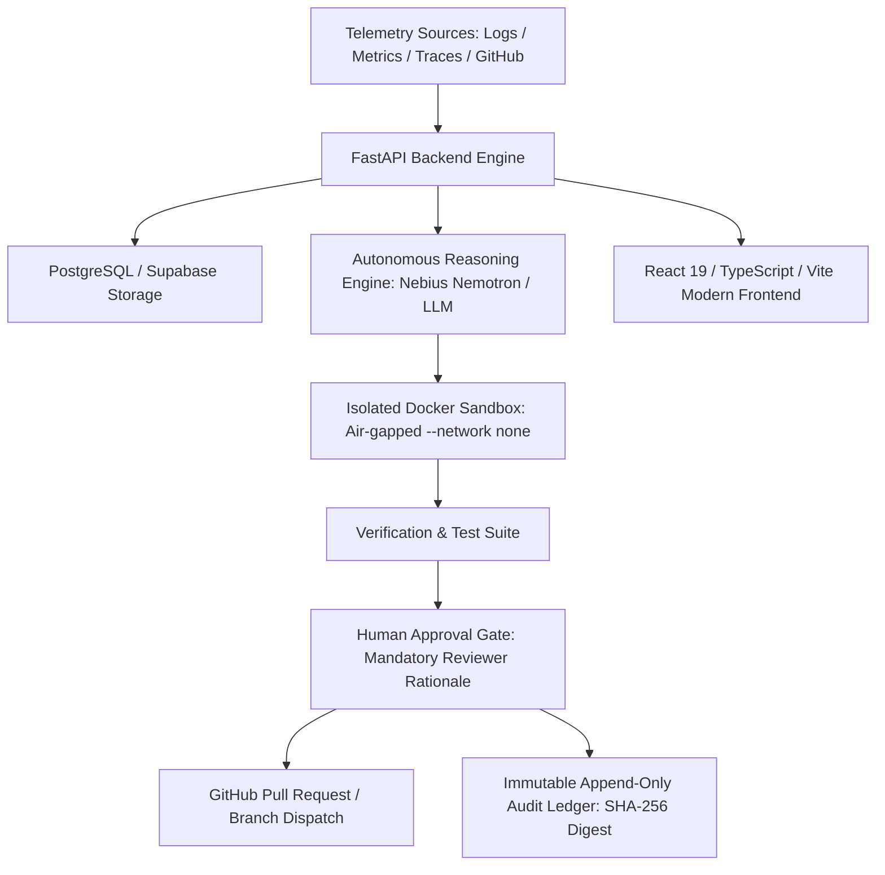

# DEVDOC — YouTube Demonstration & Hackathon Presentation Guide

> **DEVDOC**: Autonomous AI DevOps & SRE Incident Remediation Platform  
> **Repository**: [https://github.com/DEVDOC-Team/DEVDOC](https://github.com/DEVDOC-Team/DEVDOC)  
> **Working Branch**: `frontend`  
> **Target Video Length**: 5 – 7 minutes  

---

## 1. System Architecture & High-Level Overview

DEVDOC is an autonomous AI DevOps engineer designed to observe operational failures, diagnose root causes through formal epistemic reasoning, synthesize targeted remediation patches, verify changes in isolated air-gapped sandboxes, and submit them through an authoritative human approval gate.



### Core Architecture Components:
- **Frontend**: React 19, TypeScript, Vite, TanStack Query-style API client patterns, custom CSS design system with HSL variables, dark mode aesthetics, and horizontal multi-column layout.
- **Backend**: FastAPI (Python 3.11+), asynchronous SQLAlchemy with connection pooling, Pydantic v2 schemas, structured logging, and robust JWT / Bearer token authentication.
- **Persistence**: PostgreSQL 16 (or Supabase), managing projects, incidents, investigations, fix proposals, approvals, and immutable audit logs.
- **Sandbox Execution**: Docker Engine running isolated, air-gapped containers (`--network none`, read-only filesystems, ephemeral `/tmp`, 120s timeout) for dry-running patches without production risk.
- **AI Orchestration**: Structured reasoning pipelines separating observed telemetry facts from inferred diagnostic hypotheses and external operational knowledge.

---

## 2. Local Environment Setup & PowerShell Startup Commands

### Step 1: Open Terminal 1 — Start the FastAPI Backend

Run from the repository root (`D:\MY PROJECTS\DEVDOC`):

```powershell
# Navigate to repository root
cd "D:\MY PROJECTS\DEVDOC"

# Activate Python virtual environment and run Uvicorn
.\backend\venv\Scripts\Activate.ps1
python -m uvicorn app.main:app --host 127.0.0.1 --port 8000 --reload
```

*Verification:*
- Open [http://127.0.0.1:8000/api/v1/health](http://127.0.0.1:8000/api/v1/health) → Returns `{"success": true, "service": "DEVDOC", "status": "healthy"}`
- Open [http://127.0.0.1:8000/api/v1/ready](http://127.0.0.1:8000/api/v1/ready) → Returns `{"success": true, "service": "DEVDOC", "status": "ready", "checks": {"database": "ok"}}`

### Step 2: Open Terminal 2 — Start the React Frontend

Run from the `frontend/` directory:

```powershell
# Navigate to frontend directory
cd "D:\MY PROJECTS\DEVDOC\frontend"

# Launch Vite development server
npm run dev
```

*Verification:*
- Open [http://localhost:5173](http://localhost:5173) in your browser.
- You will see the new branded loading screen with the orange DevDOC logo pulsing: `Initializing DevDOC investigation engine...`.

---

## 3. Live vs Demo Mode Boundaries (Non-Negotiable Honesty)

DEVDOC strictly separates live production infrastructure from simulated demonstration scenarios:

| Characteristic | Live Mode (Default) | Demo Mode (Explicit Opt-In) |
|---|---|---|
| **Activation** | Default upon login / page load | User clicks **"Load Demo Scenario (INC-2291)"** |
| **Visual Banner** | None (clean operational interface) | Persistent orange banner: `DEMO DATA — NOT LIVE SYSTEM DATA` |
| **Data Source** | Real PostgreSQL database & FastAPI queries | Static reference fixture (`INC-2291` HikariCP leak) |
| **Approval Actions** | Dispatches real POST requests to `/api/v1/projects/{id}/.../approvals` | Local state simulation with non-destructive mutations |
| **Test Passes** | Displays actual test execution count from sandbox | Reference 482 passing tests on sample repo |
| **Exit Trigger** | Always live | User clicks **"Return to Live Mode"** / **"Exit Demo Mode"** |

---

## 4. 5–7 Minute Video Script & Recording Timeline

### Segment 1: Introduction & Brand Reveal (0:00 – 0:45)
- **Visual**: Show browser loading screen at `http://localhost:5173`. The orange-and-black DevDOC logo pulses with ambient orange glow and text: *"Initializing DevDOC investigation engine..."*. The page transitions into the dark-mode horizontal layout.
- **Narrator**:
  > *"Welcome to DevDOC — an autonomous AI DevOps and Site Reliability Engineering platform. In modern distributed systems, production incidents happen in seconds, while diagnosis and remediation take hours. DevDOC continuously ingests telemetry, diagnoses failures using rigorous epistemic reasoning, synthesizes minimal code fixes, verifies them in isolated Docker sandboxes, and gates every change behind an authoritative human approval workflow."*

### Segment 2: Health Probes, Diagnostics & Security Boundaries (0:45 – 1:45)
- **Visual**: Navigate to **Settings & Engine Health** from the left sidebar. Click **"Re-probe Endpoints"**.
- **Actions**: Point out the two active probes:
  - *Application Process Liveness* (`GET /api/v1/health` — 200 OK)
  - *Dependency Readiness Probe* (`GET /api/v1/ready` — 200 OK, verifying PostgreSQL connectivity)
  - Highlight the *Sandbox Isolation Safeguards* card (`--network none`, rootless Docker, 120s timeout).
- **Narrator**:
  > *"Before trusting an autonomous agent with production services, governance and health must be transparent. Here on our Diagnostics Deck, DevDOC continuously probes process liveness and dependency readiness against PostgreSQL. Notice our sandbox isolation policy: every candidate patch is executed inside an air-gapped Docker container with disabled networking, preventing SSRF, unauthorized outbound egress, or data leakage."*

### Segment 3: Workspace Projects & Honest Authentication (1:45 – 2:45)
- **Visual**: Navigate to **Monitored Projects**.
- **Actions**: Show the authenticated workspace, active project cards, and connected GitHub repository metadata (`DEVDOC-Team/DEVDOC`). Click **Sign Out** to demonstrate that unauthenticated users are met with a clean Sign In view rather than broken 401 alerts. Re-enter credentials / token to authenticate immediately.
- **Narrator**:
  > *"DevDOC connects directly to production repositories and telemetry workspaces. Unauthenticated access is rejected with clean Bearer token validation and automatic session recovery. Notice that our project dashboard displays real repository linkages and refuses to fabricate fake connected repos."*

### Segment 4: Investigation Console & Epistemic Reasoning (2:45 – 4:15)
- **Visual**: Navigate to **Investigation Console**. If no live incident is active, show the honest empty state. Click **"Load Demo Scenario (INC-2291)"**.
- **Actions**:
  1. Point out the persistent banner: `DEMO DATA — NOT LIVE SYSTEM DATA`.
  2. Inspect the **Phase Rail** at the top (`Detect` → `Investigate` → `Evidence` → `Reason` → `Diagnose` → `Fix proposal` → `Verify` → `Approval` → `Resolve`).
  3. Explore the **Evidence Ledger**:
     - Click **E-01** (HikariCP connection timeout logs).
     - Click **E-02** (Telemetry metric step chart: 74 → 214 connections).
     - Click **E-03** (Code diff introducing leaky retry loop).
     - Point out the distinct **FACT**, **INFERRED**, and **KNOWLEDGE** epistemic badges.
- **Narrator**:
  > *"Now let's examine DevDOC's core engine: the Investigation Console. Notice the banner clearly identifying this as a demonstration fixture. DevDOC organizes its analysis into three epistemic tiers: directly observed FACTS (such as log lines and metric spikes), INFERRED hypotheses (such as HikariCP pool starvation), and external KNOWLEDGE (such as framework socket defaults). By decoupling facts from hypotheses, hallucination is eliminated."*

### Segment 5: Human Approval Gate & Sandbox Safety (4:15 – 5:30)
- **Visual**: Scroll to the **Remediation Proposal** and click **"Review in Approval Gate"** (or select **Approval Gate** in sidebar).
- **Actions**:
  1. Inspect the candidate diff in `PaymentClient.java` (wrapping pool acquisition in try-with-resources).
  2. Show the risk matrix and automated rollback triggers.
  3. Click **"Approve & Authorize"**.
  4. Type a short rationale (e.g. `ok`) to demonstrate governance validation: *"Decision rationale must contain at least 8 non-whitespace characters"*.
  5. Enter a valid rationale: `Verified connection cleanup in sandbox regression suite. Approved for merge.`
  6. Click **Confirm Approval Decision**. Notice the immediate synchronized transition to APPROVED state.
- **Narrator**:
  > *"DevDOC does not perform rogue merges. Every automated remediation must pass through the Human Approval Gate. The SRE incident commander is presented with the candidate code diff, sandbox test reports, risk assessment, and automated rollback triggers. Our governance policy strictly requires at least 8 characters of written justification. Once authorized, the decision is recorded immutably."*

### Segment 6: Immutable Audit Ledger & Live Export (5:30 – 6:15)
- **Visual**: Click **Audit Ledger** in the sidebar.
- **Actions**:
  1. Show the append-only record table with SHA-256 digests and actor identities.
  2. Filter by action or hash in the search bar.
  3. Click **"Export JSON"** to show real compliance and SOC2 export readiness.
  4. Click **"Return to Live Mode"** to return to empty live states cleanly.
- **Narrator**:
  > *"Every action — from metric ingestion to human approval — is stamped into an append-only audit ledger with cryptographic SHA-256 digests. This guarantees complete auditability for SOC2 and regulatory compliance. With one click, teams can export the full ledger as structured JSON, or return instantly to live monitoring."*

### Segment 7: Conclusion & Vision (6:15 – 6:45)
- **Visual**: Return to **System Overview** / **Investigation Console** with the DevDOC logo visible in the header.
- **Narrator**:
  > *"DevDOC transforms DevOps from reactive chaos into structured, verified, autonomous reliability. It doesn't replace the engineer; it equips them with an tireless AI partner that observes, diagnoses, tests, and presents verified solutions for human sign-off. Thank you for watching DevDOC!"*

---

## 5. Troubleshooting & FAQ for Presenters

### Q1: The Monitored Projects view shows "Authentication Required"
- **Solution**: Click **Sign In** in the top bar or sidebar, enter your access token, and click **Authenticate**. The application automatically stores the token in `localStorage` and attaches the `Authorization: Bearer <token>` header to all subsequent API calls.

### Q2: Backend returns 401 Unauthorized
- **Cause**: Token expired or invalid JWT secret.
- **Fix**: The frontend now automatically catches 401 errors, clears stale credentials, and prompts for re-authentication without UI crashes or raw error toasts.

### Q3: How do I switch back to clean live data during a demo?
- **Fix**: Any view showing demo data has a prominent **"Return to Live Mode"** or **"Exit Demo Mode"** button. Clicking it immediately unloads simulated fixtures and requests live data from the backend.

### Q4: Vite port 5173 is already in use
- **Fix**: Run `npm run dev -- --port 5174` and open [http://localhost:5174](http://localhost:5174).

---

*Authored for the DEVDOC Hackathon Release & YouTube Demonstration.*
